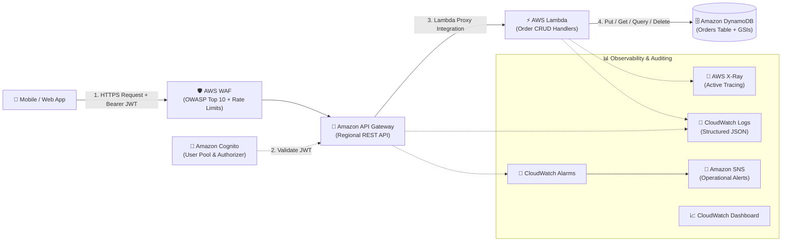

# 🚀 AWS Serverless Order Management API

[](https://github.com/dineTH2003-dev/aws-serverless-order-management/actions/workflows/ci.yml)
[](https://github.com/dineTH2003-dev/aws-serverless-order-management/actions/workflows/cd.yml)
[](https://www.terraform.io/)
[](https://www.python.org/)
[](LICENSE)

A production-grade, enterprise-ready **Serverless Order Management REST API** built on Amazon Web Services (AWS). Designed to showcase cloud architecture best practices, defense-in-depth security, cost optimization, automated testing, and zero-downtime GitOps CI/CD.

---

## 🏛️ System Architecture



---

## 🛠️ AWS Services & Architectural Decisions

| Service | Architecture Role | Key Design Choices |
| :--- | :--- | :--- |
| **AWS WAF** | Perimeter Security | Regional WebACL with AWS Managed Common Rules (OWASP Top 10), Known Bad Inputs, SQLi protection, and per-IP rate limiting (2,000 req / 5 min). |
| **Amazon Cognito** | Identity & Access | User Pool with email-based authentication, strong password policy, optional TOTP MFA, audit security, and App Client configured without secrets for mobile/SPA. |
| **Amazon API Gateway** | Public REST Endpoint | Regional REST API, Cognito User Pool Authorizer, request payload schema validation, CORS preflight handlers, access logging, and method throttling (1,000 burst / 500 RPS). |
| **AWS Lambda** | Stateless Compute | Single Responsibility handlers (`create_order`, `get_order`, `list_orders`, `delete_order`), Python 3.12, 256 MB memory, least-privilege IAM roles, and AWS X-Ray active tracing. |
| **Amazon DynamoDB** | Persistent NoSQL Store | Single-table access patterns with customer-managed KMS encryption, Point-in-Time Recovery (PITR), TTL auto-expiry, and Global Secondary Indexes (GSIs). |
| **CloudWatch & SNS** | Monitoring & Alerting | Metric alarms on 5XX errors, high latency (P95 > 2s), and Lambda failures routed to SNS alerts, plus a unified operational dashboard. |
| **Terraform** | Infrastructure as Code | Modular architecture (`dynamodb`, `cognito`, `lambda`, `api_gateway`, `waf`, `monitoring`), remote S3 backend with DynamoDB state locking. |
| **GitHub Actions** | CI/CD Automation | OIDC passwordless authentication (no long-lived AWS keys in secrets), PR linting & unit testing, and automated deployment on merge. |

---

## 📊 DynamoDB Data Modeling

The database uses access-pattern-driven NoSQL modeling:

### Primary Table: `order-management-orders-<env>`
- **Partition Key (`PK`):** `ORDER#<orderId>`
- **Sort Key (`SK`):** `METADATA`
- **Billing Mode:** `PAY_PER_REQUEST` (On-Demand auto-scaling)
- **Encryption:** Customer-Managed AWS KMS Key (`alias/order-management-orders-<env>`)
- **Point-in-Time Recovery:** Enabled

### Global Secondary Indexes (GSIs)

| Index Name | Partition Key | Sort Key | Projection | Target Access Pattern |
| :--- | :--- | :--- | :--- | :--- |
| **`userId-createdAt-index`** | `userId` (S) | `createdAt` (S) | `ALL` | Query all orders for a specific user, sorted newest-first |
| **`status-createdAt-index`** | `status` (S) | `createdAt` (S) | `ALL` | Query and filter orders by lifecycle state across time |

---

## 🔒 Defense-in-Depth Security

1. **Perimeter Layer (AWS WAF):** Filters and drops malicious requests, bad user-agents, SQL injection payloads, and DDoS floods before reaching API Gateway.
2. **Gateway Layer (Amazon Cognito):** Validates the Bearer JWT token signature, issuer, and expiration. Unauthenticated requests receive `401 Unauthorized` without incurring compute charges.
3. **Compute Layer (IAM Least Privilege):** Each Lambda execution role can only perform exact DynamoDB actions (`PutItem`, `GetItem`, `DeleteItem`, `Query`) scoped to the specific table ARN and index ARNs.
4. **Data Isolation (Tenant Isolation):** The Lambda business logic verifies the `sub` claim from the Cognito JWT against the order's `userId`. Users cannot access or delete orders owned by other users (`403 Forbidden`).
5. **Storage Layer (KMS Encryption):** All data at rest is encrypted using dedicated AWS KMS customer-managed keys.

---

## 📡 API Specification

Full OpenAPI 3.0 specification available at [`docs/api-spec.yaml`](docs/api-spec.yaml).

| HTTP Method | Route | Description | Auth Required | Status Codes |
| :--- | :--- | :--- | :---: | :--- |
| `POST` | `/orders` | Create a new order | Yes (Cognito) | `201 Created`, `400 Bad Request` |
| `GET` | `/orders` | List orders for current user | Yes (Cognito) | `200 OK`, `400 Bad Request` |
| `GET` | `/orders/{orderId}` | Get single order by ID | Yes (Cognito) | `200 OK`, `403 Forbidden`, `404 Not Found` |
| `DELETE` | `/orders/{orderId}` | Delete order by ID | Yes (Cognito) | `204 No Content`, `403 Forbidden`, `404 Not Found` |

### Sample Create Order Request Body
```json
{
  "items": [
    {
      "productId": "prod-101",
      "name": "AWS Certified Solutions Architect Study Guide",
      "quantity": 1,
      "unitPrice": 49.99
    }
  ],
  "shippingAddress": "123 Cloud Avenue, Seattle, WA 98101",
  "notes": "Please leave at front door"
}
```

---

## 💻 Local Development & Setup

### 1. Prerequisites
- Python 3.12+
- Terraform >= 1.6.0
- AWS CLI v2 configured with `account2` profile (`265283365424`)

### 2. Environment Setup
```bash
# Clone the repository
git clone https://github.com/dineTH2003-dev/aws-serverless-order-management.git
cd aws-serverless-order-management

# Create and activate virtual environment
python3 -m venv .venv
source .venv/bin/activate

# Install dependencies
pip install -r requirements-dev.txt
```

### 3. Run Unit Tests
```bash
# Execute unit test suite with Moto DynamoDB mocking
pytest tests/unit/ -v
```

---

## 🚀 Deployment Guide

### Step 1: Bootstrap Remote State Backend
Create the S3 bucket and DynamoDB locking table in AWS account `account2`:
```bash
chmod +x scripts/bootstrap_terraform_backend.sh
AWS_PROFILE=account2 ./scripts/bootstrap_terraform_backend.sh
```

### Step 2: Configure GitHub Actions OIDC (Optional for CI/CD)
```bash
chmod +x scripts/setup_github_oidc.sh
AWS_PROFILE=account2 ./scripts/setup_github_oidc.sh
```

### Step 3: Deploy via Terraform
```bash
cd infra

# Initialize Terraform with dev remote backend
terraform init -backend-config=environments/dev/backend.tfvars

# Review execution plan
terraform plan -var-file=environments/dev/terraform.tfvars

# Deploy to AWS
terraform apply -var-file=environments/dev/terraform.tfvars
```

---

## 💰 Cost Optimization Analysis

Serverless architecture guarantees **zero idle costs**:

| Component | Pricing Tier | Monthly Cost (100k requests/month) |
| :--- | :--- | :--- |
| **AWS Lambda** | First 1M requests/mo free | **$0.00** |
| **Amazon API Gateway** | $3.50 per 1M REST calls | **$0.35** |
| **Amazon DynamoDB** | On-Demand (writes: $1.25/M, reads: $0.25/M) | **~$0.15** |
| **Amazon Cognito** | 50,000 monthly active users (MAU) free | **$0.00** |
| **AWS WAF** | $5.00/month (WebACL) + $1.00/M requests | **$5.10** |
| **CloudWatch & Logs** | 5 GB ingestion free tier | **$0.00** |
| **Total Estimated Cost** | | **~$5.60 / month** |

---

## 📂 Project Directory Structure

```
aws-serverless-order-management/
├── .github/
│   └── workflows/
│       ├── ci.yml                     # PR linting & unit tests
│       └── cd.yml                     # OIDC-based automated AWS deployment
├── docs/
│   ├── api-spec.yaml                  # OpenAPI 3.0 specification
│   └── architecture.md                # In-depth architectural documentation
├── infra/
│   ├── main.tf                        # Root Terraform orchestration
│   ├── variables.tf                   # Global input variables
│   ├── outputs.tf                     # Root stack outputs
│   ├── backend.tf                     # Remote S3 state backend config
│   ├── environments/
│   │   ├── dev/                       # Dev backend & tfvars
│   │   └── prod/                      # Prod backend & tfvars
│   └── modules/
│       ├── api_gateway/               # REST API, methods, validators, logging
│       ├── cognito/                   # User Pool, App Client, Auth Domain
│       ├── dynamodb/                  # Orders table, GSIs, KMS encryption
│       ├── lambda/                    # 4 Functions, IAM roles, X-Ray
│       ├── monitoring/                # CloudWatch Dashboard, Alarms, SNS
│       └── waf/                       # WAFv2 WebACL & managed rules
├── scripts/
│   ├── bootstrap_terraform_backend.sh # S3 bucket & DynamoDB lock table setup
│   ├── seed_data.sh                   # DynamoDB test data seeding
│   └── setup_github_oidc.sh           # GitHub Actions OIDC IAM role setup
├── src/
│   ├── orders/                        # Lambda function handlers
│   │   ├── create_order.py
│   │   ├── get_order.py
│   │   ├── list_orders.py
│   │   └── delete_order.py
│   └── shared/                        # Shared reusable layer
│       ├── db.py                      # DynamoDB client abstraction
│       ├── exceptions.py              # Domain errors & HTTP response helpers
│       └── models.py                  # Pydantic v2 schemas & Decimal parsing
├── tests/
│   ├── conftest.py                    # Moto mock fixtures & AWS environment
│   ├── helpers.py                     # API Gateway event builders
│   └── unit/                          # 16 unit tests for handlers and models
├── Makefile                           # Developer workflow shortcuts
└── pyproject.toml                     # Pytest, Black, Ruff configurations
```

---

## 👨‍💻 Author

**Dineth Wijesinghe**  
- AWS Account: `account2` (`265283365424`)  
- GitHub: [@dineTH2003-dev](https://github.com/dineTH2003-dev)
